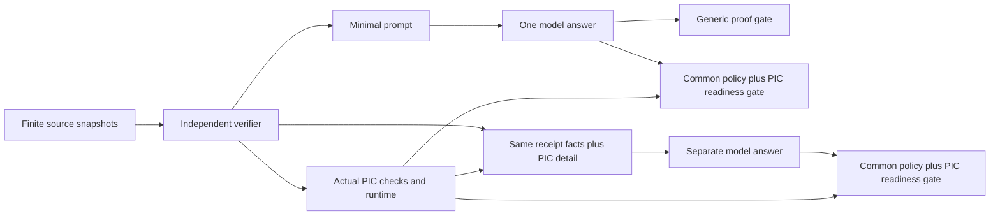

# R4 completed research record: locating PIC contribution

R4 completed on 2026-10-20 with PIC 1.1.0 unchanged. The same local model digest, generation settings and context/output caps are retained. Existing R1/R2/R3 records remain intact. This guide interprets the new results; it does not replace the frozen report or endpoints.

The measured result is **no observed incremental task benefit on these authored cases**. Detailed PIC feedback adds substantial model-processing cost. A minimal model interface can coexist with actual PIC operations at much smaller measured additional backend cost. Caching works in both backends; saving PIC-native rechecks is distinct from beating a generic cache.

## What was isolated



G_minimal/P_minimal replay the exact same answer; this is an intentional negative control for the model channel, not two independent samples. PIC gate differences could arise from component readiness, not from an unseen different answer. The final merged PIC runtime records each generated answer, while task admission uses verified component states and the common aggregate proof rule; global framework settlement is not the task oracle.

The primary comparison P_full versus P_minimal holds the acquired receipts and backend fixed. Extra native/runtime metadata and representation length form one feedback-package intervention. There is no extra authoritative observation or aggregate gold label in P_full.

## Results

| Confirmatory endpoint | Generic + minimal | PIC + minimal | PIC + detail |
| --- | ---: | ---: | ---: |
| Supported decision, after frozen JSON extraction | 32/32 | 32/32 | 32/32 |
| Parsed field/ID contract | 32/32 | 32/32 | 32/32 |
| Supported completion yield | 23/23 | 23/23 | 23/23 |
| Unsupported model completion | 0/32 | 0/32 | 0/32 |
| Unsafe gate admission | 0/32 | 0/32 | 0/32 |

P_full minus P_minimal is 0.00 percentage points; wins/ties/losses 0/32/0. Answer hashes themselves match on 32/32 main pairs. Episode sign-flip p=1.0. Eight episodes are the working blocks; 32 snapshots are not independent draws. Both conditions reach this benchmark ceiling. The degenerate [0,0] empirical bootstrap does not prove equivalence or absence of an effect on unseen tasks. The task independent sensitivity interval is [-12.80,+12.80] percentage points and is not the primary dependence-aware inference.

The task is a three-source conjunction. A single authorized failing witness can settle NONCOMPLIANT even with unrelated missing evidence; COMPLIANT needs all three passing witnesses. Nine holding cases and 23 determinable cases are retained. Per-source verdicts are explicit, creating a strong control and limited headroom for assistance.

## Measured cost and its accounting

| Hypothetical standalone workflow | Seconds | Model input / output tokens |
| --- | ---: | ---: |
| G_minimal | 423.181 | 20754 / 2727 |
| P_minimal | 424.836 | 20754 / 2727 |
| P_full | 2323.767 | 136454 / 2727 |

PIC + minimal adds 1.656 measured seconds over the generic workflow estimate (0.391%). Its recorded PIC processing is 1.656 seconds over 32 cases. PIC + detail costs 5.470 times PIC + minimal; its model input count is 6.575 times as large. The large difference is in model processing, not additional PIC computation. This does not isolate pure prompt length from representation, prefix caching or background load.

Standalone estimates assign the full one observed minimal generation to each hypothetical backend. They are not three independently measured model workflows and must not be summed as physical compute. Actual execution has 73 model calls: warmup 1, pilot 8, main 64; all are OK with zero retries/truncations. Physical API counts are 176,036 input and 6,159 output tokens. Main panel wall time is 2753.909 seconds. Energy, FLOPs, continuous GPU utilization and financial cost remain unknown. Allocation snapshots report size_vram=0.

## Reuse: savings within PIC versus additional value over generic caching

Both the original instrumented benchmark and the separately registered lean-import replication completed 24 conditions / 72 child processes each. Every cached/no-cache consumer preserves the supported positive result. Producers and consumers are separate processes with distinct task/receipt IDs; fanout is repeated work in a consumer process, not autonomous agents. No artificial delays stand in for verification.

The original harness imported PIC in generic children too. That timing record is retained. The lean replication verifies PIC is absent from every generic child and present in every PIC child. The following are lean parent-wall means of two repeats, including producer cost, fresh process startup, execution and persisted I/O:

| Samples | Fanout | Generic cached seconds | PIC cached seconds | PIC no-cache seconds |
| ---: | ---: | ---: | ---: | ---: |
| 16 | 1 | 0.5366 | 2.4213 | 2.3963 |
| 16 | 8 | 0.5391 | 2.4891 | 2.5728 |
| 4,096 | 1 | 0.5436 | 2.4295 | 2.4397 |
| 4,096 | 8 | 0.5673 | 2.6211 | 2.6024 |
| 65,536 | 1 | 0.5927 | 2.4808 | 2.5374 |
| 65,536 | 8 | 0.6448 | 2.8191 | 3.0657 |

For 65,536 samples and fanout 8, PIC caching saves about 0.247 seconds against its own no-cache path, but remains slower than generic caching (about 2.819 versus 0.645 seconds). Both generic and PIC consumers skip 54 independent domain calls per benchmark; PIC additionally skips 54 native calls introduced by its own path. The shared verification saving is not PIC-specific. Increasing the cost of a shared verifier would benefit both equally when valid hit rates remain equal.

Two repeats, simple arrays, uncontrolled OS caches and instrumentation limit timing inference. PIC saves more SDK/runtime artifacts in this implementation. These are trace-recording workflow costs, not a lower bound on optimized PIC CPU cost or a universal break-even threshold. Keep original and lean observations separate; do not pool them.

## Interpretation limits and analysis disclosures

- Backend replay parity validates this composition and its admission behavior; identical model scores are structural and do not establish population equivalence.
- The strong explicit-verdict control and simple conjunction reach a ceiling. One model/digest/seed/host and eight authored episodes cannot establish universal ineffectiveness.
- Common source/issuer/task/recipient/TTL checks are external in both workflows. Raw PIC metadata acceptance is distinct from protected task admission. Development packet identity and production content-reference validation do not constitute production identity assurance.
- Routing, source acquisition, aggregate proof policy and cache storage are supplied by the orchestrator. PIC-native planning, autonomous coordination, adaptive evidence acquisition, engineering effort and auditability benefits are unmeasured.
- The frozen parser extracts a JSON object from surrounding text. All 64/64 actual main answers are fenced; raw JSON-only compliance is 0/32 per feedback condition, while decoded field/ID contracts pass. No grades are retroactively tightened. See the contract audit.
- The frozen backend-yield comparison helper uses 32 planned cases. Protocol yield and arm tables correctly use 23 eligible cases. A separately disclosed audit reports 23/23 versus 23/23; no primary grade, denominator or source is changed. Do not read the old 32-pair interval as a 23-case yield interval.

The practical inference for this tested use is to keep task facing feedback small when the verifier already supplies sufficient per-source verdicts. PIC can remain behind that interface if its packet/runtime records are required. This experiment demonstrates that composition, not an additional task, safety or cost advantage over the strong generic ledger. Standardization and auditability remain possible benefits requiring their own measures.

## Records, identities and checks

- [Frozen report](EXPERIMENT_REPORT_PIC_1_1_0_R4.md) and [sanitized rows](EXPERIMENT_SUMMARY_PIC_1_1_0_R4.json)
- [Protocol](PROTOCOL_PIC_1_1_0_R4.md), [reproduction](REPRODUCIBILITY_PIC_1_1_0_R4.md), [scope notes](PIC_1_1_0_R4_SCOPE_NOTES.md)
- [Pilot gate](PIC_1_1_0_R4_PILOT_GATE.json), [pilot freeze](PIC_1_1_0_R4_PREREG_PILOT.json), [main freeze](PIC_1_1_0_R4_PREREG_MAIN.json)
- [Lean protocol](PROTOCOL_PIC_1_1_0_R4_LEAN.md), [registration](PIC_1_1_0_R4_LEAN_PREREG.json), [all lean timing rows and import checks](PIC_1_1_0_R4_LEAN_RESULTS.json)
- [Contract audit](PIC_1_1_0_R4_CONTRACT_AUDIT.json), [secondary denominator audit](PIC_1_1_0_R4_ANALYSIS_AUDIT.json), [artifact validation](PIC_1_1_0_R4_VALIDATION.json)
- [Primary private archive identity](PIC_1_1_0_R4_PRIVATE_ARCHIVE_IDENTITY.json) and [lean archive identity](PIC_1_1_0_R4_LEAN_PRIVATE_ARCHIVE_IDENTITY.json); contents remain private

Methods were committed before pilot at `2825488`, unchanged main before inference at `3ab0ebd`, lean cost replication before cost outcomes at `e01a60a`, and secondary analysis disclosure before answer grading at `5507cd1`. These are local commits, not independently public timestamped registration. Both freezes protect the same 54 files. The installed 617-file PIC payload and all 2,884 earlier tracked/raw/archive bytes remain unchanged. Pre-inference tests: 267 passed, including real PIC and independent hand, boundary and metamorphic checks. Package version stays 0.2.0.

Read-only public checks after dependencies are available:

```powershell
.venv-pic110/Scripts/python.exe -m pic_local_llm_phase_experiment.pic110r4_analysis --check-public
.venv-pic110/Scripts/python.exe scripts/audit_pic110r4_analysis.py --check-public
.venv-pic110/Scripts/python.exe scripts/public_safety_audit.py
```

Arithmetic checks do not regrade each original answer. Exact regrading needs private responses and frozen source contexts. Existing panels/archives are never overwritten.
